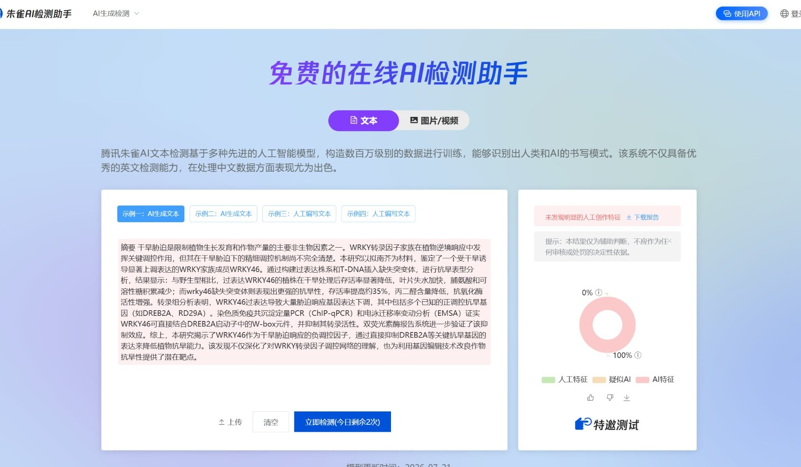
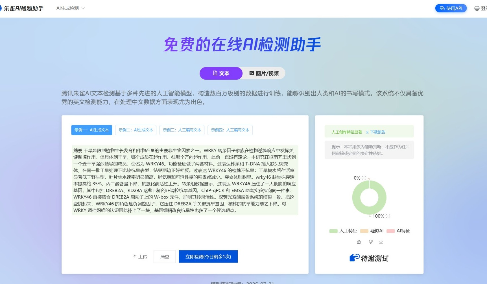

# aigc-humanizer-skill

[](https://creativecommons.org/licenses/by-nc-sa/4.0/)
[](https://www.python.org/)

文本或者论文总是 AI 味很重？明明句子都是对的，但是一眼就看得出来是 AI 写的，AIGC 检测也长篇大论地标红。这个 skill 把这类文字逐段改一遍，改完再检查有没有改坏。

适用于论文、技术文档、个人陈述等较为严肃的场景，安装极其简单，无门槛，跑在你的 agent 里，不用起服务，不用配 API Key。

朱雀 AI 检测实测：同一段 407 字摘要，改前 0% 人工特征，改后 100% 人工特征。[截图见下](#改写对照)。

规则和提示词来自 [chi111i/BypassAIGC](https://github.com/chi111i/BypassAIGC)。原项目是个 Web 服务，本仓库只留了它的去痕规则和分段逻辑，改写交给 agent 直接做。

## 安装

**最省事的方法**：把下面这段提示词交给你的 agent，让它自己安装。

```
把这个仓库装成我的 skill：
https://github.com/shandaiqiecheng-commits/aigc-humanizer-skill

装好告诉我一声。
```

**手动安装**：

```bash
git clone https://github.com/shandaiqiecheng-commits/aigc-humanizer-skill.git
```

然后把 `aigc-humanizer-skill` 目录整个放进你的 agent 的 skills 目录。

处理 `.docx` 需要装一下 `python-docx`，其余功能只用标准库：

```bash
pip install python-docx
```

## 哪些 agent 能用

支持 `SKILL.md` 的都能装，常见的有 Claude Code、WorkBuddy、CodeBuddy、Cline、Trae、Gemini CLI。

如果你的 agent 没有 skill 机制，把 `SKILL.md` 当规则文件放进项目目录也能生效，只是脚本要自己手动跑。

## 能处理什么文件

| 格式 | 怎么处理 |
|---|---|
| `.md` / `.txt` | 直接改 |
| `.docx` | 改完写回原文档，标题级别、字体、缩进、行距都留着 |
| `.tex` | 只动正文，命令、公式、表格、参考文献一概不碰 |

docx 格式的问题：句中的加粗和斜体会统一成段首格式。中文论文正文一般不靠行内加粗强调，影响不大，但交付前还请人工审查。

## 它做什么

逐段改写，每段改完只交这一段，不整篇重写。整篇重写会让全文风格变得整齐，而整齐本身就是机器味。人写长文，前后段的用词习惯是有波动的。

改两遍。第一遍删套话、拆模板句、把"通过……实现……"这种空架子换成具体机制。第二遍专门修第一遍留下的后遗症：句子被删短之后长度容易趋同，得重新拉开。

改完自动和原文比对，查三件事：段落数有没有变、原文的引用编号和数字有没有丢、标题和参考文献有没有被误改。任一条不过就不让交付。

## 改写对照

一段 407 字的植物生物学摘要，原文和改完的样子。两张截图是同一段文字丢进[朱雀 AI 检测助手](https://matrix.tencent.com/ai-detect/)的结果，检测时间 2026-10-29，站点模型版本 2026-07-21。左侧标红标绿是逐句判定。

**原文，0% 人工特征**



**改完，100% 人工特征**



**原文**

> 摘要 干旱胁迫是限制植物生长发育和作物产量的主要非生物因素之一。WRKY转录因子家族在植物逆境响应中发挥关键调控作用，但其在干旱胁迫下的精细调控机制尚不完全清楚。本研究以拟南芥为材料，鉴定了一个受干旱诱导显著上调表达的WRKY家族成员WRKY46。通过构建过表达株系和T-DNA插入缺失突变体，进行抗旱表型分析，结果显示：与野生型相比，过表达WRKY46的植株在干旱处理后存活率显著降低，叶片失水加快，脯氨酸和可溶性糖积累减少；而wrky46缺失突变体则表现出更强的抗旱性，存活率提高约35%，丙二醛含量降低，抗氧化酶活性增强。转录组分析表明，WRKY46过表达导致大量胁迫响应基因表达下调，其中包括多个已知的正调控抗旱基因（如DREB2A、RD29A）。染色质免疫共沉淀定量PCR（ChIP-qPCR）和电泳迁移率变动分析（EMSA）证实WRKY46可直接结合DREB2A启动子中的W-box元件，并抑制其转录活性。双荧光素酶报告系统进一步验证了该抑制效应。综上，本研究揭示了WRKY46作为干旱胁迫响应的负调控因子，通过直接抑制DREB2A等关键抗旱基因的表达来降低植物抗旱能力。该发现不仅深化了对WRKY转录因子调控网络的理解，也为利用基因编辑技术改良作物抗旱性提供了潜在靶点。

**改完**

> 摘要 干旱是限制植物生长发育和作物产量的主要非生物因素之一。WRKY 转录因子家族在植物逆境响应中发挥关键调控作用。但具体到干旱，哪个成员在起作用、往哪个方向起作用，此前一直没有定论，本研究在拟南芥里找到一个受干旱强烈诱导的成员，命名为 WRKY46。功能验证做了两套材料。过表达株系和 T-DNA 插入缺失突变体，在同一批干旱处理下比较抗旱表型，结果两边正好相反。过表达 WRKY46 的植株不抗旱：干旱复水后存活率显著低于野生型，叶片失水速率明显偏高，脯氨酸和可溶性糖的积累都减少。突变体则耐旱。wrky46 缺失株存活率提高约 35%，丙二醛含量下降，抗氧化酶活性上升。转录组数据显示，过表达 WRKY46 压住了一大批胁迫响应基因，其中包括 DREB2A、RD29A 这些已知的正调控抗旱基因。ChIP-qPCR 和 EMSA 两套实验指向同一件事：WRKY46 直接结合 DREB2A 启动子上的 W-box 元件，抑制其转录活性。双荧光素酶报告系统的结果一致。把这些拼起来，WRKY46 的角色是负调控因子，它压住 DREB2A 等关键抗旱基因，植株的抗旱能力随之下降。对 WRKY 调控网络的认识因此补上了一块，基因编辑改良抗旱性也多了一个候选靶点。

**工具报告**

```
段落数      1 → 1   OK
中文字数    407 → 379   (-28, -6.9%)
整体修改率  38.9%
AI 套话     0 → 0 处（高危 0 → 0）
句长 CV     改前  中文 0.32（10 句，均长 40.7）
            改后  中文 0.40（12 句，均长 31.1）
破折号      0 → 0 处
结论：通过
```

改动集中在三处：`通过构建……进行……，结果显示：` 换成两句短的；`而wrky46缺失突变体则表现出更强的抗旱性` 拆成 `突变体则耐旱。`；结尾的 `不仅……也……` 拆开，不再用一个长句兜住两层意思。术语、数字、35%、基因名全部原样保留。

这段原文其实没多少套话可删，扫下来 0 处，能动的只有句子节奏。分数能翻过来，靠的是打散「通过……进行……结果显示：」这类流水线结构，把 10 个长度接近的长句改成 12 个长短交错的句子。原稿句句都在 40 字上下，读起来是平的；改完最长的六十多字，最短的只有 7 个字。

## 做不到什么

- 它改的是句子和用词，改不了文章结构。整篇三段式、每段一个论点加一个例子，光改句子救不回来。
- 检测器在迭代，任何方法都有保质期。这套规则更适合看困惑度和突发性的检测器。
- 不处理"降重"。降查重率和去 AI 腔是两件事，混着做会把文字改坏。

## 相对原版的改动

| | 原版 | 本仓库 |
|---|---|---|
| 形态 | FastAPI + React Web 服务 | agent skill，无服务 |
| 配置 | `.env` + 4 组 API Key + 代理地址 | 零配置 |
| 输入 | 网页粘贴纯文本 | md / txt / **docx** / **tex** |
| 校验 | 无 | 3 类硬失败 + 4 类警告 |
| 规则 | 一段密集字符串 | 18 类分类表，带示例 |
| 未保留 | 卡密、并发队列、流式输出、历史压缩 | 单用户场景用不上 |

去痕规则、三段提示词、分段参数（500 字上限 / 15 字跳过）原样继承，没有改动。

## 目录

```
SKILL.md                    agent 读的操作手册
assets/
  before.jpg                改写前，朱雀判 0% 人工特征
  after.jpg                 改写后，朱雀判 100% 人工特征
references/
  humanizer-rules.md        18 类去痕规则 + 改写示例
  prompts.md                三段提示词原文 + 参数建议
scripts/
  aigc_pipeline.py          split / scan / check / writeback
  check_tex.py              LaTeX 结构校验
evals/
  cases.md                  改写对照样例（恰当 / 过度）
```

## 许可

[CC BY-NC-SA 4.0](LICENSE)：署名、非商业、相同方式共享。要商用得先找原作者 [Yan Wenxin](https://github.com/chi111i) 拿授权。

侧边栏显示 Other 是正常的。GitHub 只认 13 种 OSI 许可，CC 的非商业系列不在里面，所以 CC BY-NC-SA 4.0 一律显示 Other，跟文件内容无关。以 `LICENSE` 为准。
